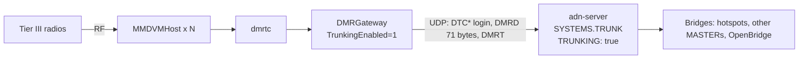

# DMR Tier III trunking (dmrtc + DMRGateway)

A **MASTER** with **`TRUNKING: true`** accepts **DMR Tier III sites**. A site is the **dmrtc** trunking controller (qradiolink) with **DMRGateway** set to **`TrunkingEnabled=1`**. Both speak the **Homebrew DMR trunking protocol v0.6** (DL5ABM / YO8RZZ). Brandmeister calls this link a "DMRTC link".

A site logs in like a hotspot, under other opcode names. Then it tells the server three things: which talkgroups it wants, where its radios are, and its short data (SMS, status). It also carries **many calls at the same time** over one link.

Wire format: [Tier III protocol](../protocols/tier3.md).

## How it fits {#architecture}



| | Hotspot (classic HBP) | Tier III site |
|---|---|---|
| Login | `RPTL` / `RPTK` / `RPTC` / `RPTO`, `RPTPING` | `DTCL` / `DTCK` / `DTCC` / `DTCO`, `DTCPING` |
| Voice frames | `DMRD`, 55 bytes | `DMRD`, 71 bytes (55 + a 16-byte call UUID) |
| Talkgroups | OPTIONS, statics, user-activated TGs | DMRT **subscriptions**, held until the site drops them |
| Calls at once | 2 (one per timeslot) | Many: no timeslot contention |
| Where a radio is (private calls) | Learned from traffic (`SUB_MAP`) | DMRT **registration**, then traffic |
| Short data | DMR data frames | DMRT UDT and status messages between sites |

## Quick install {#quick-install}

`tools/install.sh` installs the server on Debian 12/13, Ubuntu 22.04+, Raspberry Pi OS bookworm or Armbian (amd64, arm64 and armhf; for example a VPS, a Raspberry Pi or an Odroid XU4). It does the following:

- installs the packages, the `adn` user and a local MariaDB;
- fetches the code into `/opt/adn-server` and creates its Python environment;
- generates `adn-server.yaml` with the `TRUNK` MASTER enabled, and `adn-echo.yaml`;
- creates the `adn-server` and `adn-echo` systemd services, and opens the ports when `ufw` or `firewalld` is active.

```bash
curl -fsSL https://raw.githubusercontent.com/ea5gvk/ADN-DMR-Peer-Server/feat/dmr-tier3-trunking/tools/install.sh \
  | sudo bash -s -- --server-id 2141
```

At the end it prints the passwords and the `DMRGateway.ini` block, and saves them in `/root/adn-server-install.txt`. Run again, it updates the code and dependencies and keeps the configuration and the database. Options: `--help`.

## Server configuration {#server-configuration}

Add a MASTER of its own with its own UDP port. The commented `TRUNK:` block in `adn-server.example.yaml` is a ready template:

```yaml
SYSTEMS:
  TRUNK:
    MODE: MASTER
    ENABLED: true
    TRUNKING: true
    REPEAT: true          # sites of this system hear each other
    MAX_PEERS: 10         # number of sites
    IP: ""
    PORT: 62037           # the port DMRGateway logs in to
    PASSPHRASE: "change-me"
    USE_ACL: true
    REG_ACL: DENY:1       # site IDs
    SUB_ACL: DENY:1       # radio IDs (registrations)
    TGID_TS1_ACL: PERMIT:ALL
    TGID_TS2_ACL: PERMIT:ALL
    SINGLE_MODE: false
```

- **Authentication** works as for hotspots. A per-ID password from `GLOBAL.USERS_PASS` comes first, else the system `PASSPHRASE`. `REG_ACL`, `ALLOW_UNREG_ID` and `MAX_PEERS` apply to site IDs.
- **The system is Tier III only.** A classic `RPTL` (a hotspot, or a DMRGateway without `TrunkingEnabled=1`) gets `MSTNAK`. Keep hotspots on another MASTER or on the [hotspot proxy](hotspot-proxy.md).
- **`REPEAT`** (default `true`): a call from one site goes to the other sites of this system that want it. With `false`, sites of the same system do not hear each other; their calls still go through the bridges.

### Rules the validator enforces {#validation}

With `TRUNKING: true`, the server refuses to start (and `--doctor` reports it) when it finds:

| Setting | Why |
|---------|-----|
| `MODE` other than `MASTER` | Sites log in like hotspots. |
| The system is `PROXY.TARGET_SYSTEM` | The integrated proxy does not carry DTC* logins or DMRT. Give the trunking MASTER its own system and `PORT`. |
| `PORT` missing or not an integer > 0 | Sites log in on the system's own UDP port. |
| `PORT` equal to `PROXY.LISTEN_PORT` or `OBP_PROXY.LISTEN_PORT` | The binds would collide (only checked for enabled systems). |
| `GENERATOR` > 1 | One port carries every site; use `MAX_PEERS`. |
| `SINGLE_MODE: true` | A site's talkgroups are its subscriptions. |
| Non-empty `TS1_STATIC` / `TS2_STATIC` | Sites subscribe their own talkgroups. |
| `DEFAULT_REFLECTOR` other than `0` | Not supported on a trunking system. |

### ACLs {#acls}

Each scope (`GLOBAL`, then the system) applies only when its `USE_ACL` is `true`, as for voice:

- **Registration** of a radio: accepted when `SUB_ACL` permits the radio ID in every active scope.
- **Subscription** to a talkgroup: accepted when the TS1 lists (`TGID_TS1_ACL`) or the TS2 lists (`TGID_TS2_ACL`) permit it in every active scope. A site has no timeslots.
- **Voice** from a site is checked against the list of the slot bit dmrtc puts in the frame. Keep `TGID_TS1_ACL` and `TGID_TS2_ACL` the same on a trunking system, so that a subscribed talkgroup is never dropped on one slot.

### Reload and restart {#reload}

- **`SIGHUP`** keeps the sites, their subscriptions and their registrations. After the reload the server re-applies the subscribed talkgroups (log line `Tier III subscriptions re-applied`). It does the same after the system's bridge reset.
- **Adding or removing `TRUNKING`** on an existing system (or changing its `MODE`) restarts that system. Its peers are dropped (sites get `DTCCL`) and they log in again.
- **Removing the system** sends `DTCCL` to its sites and releases their talkgroups.
- **A process restart** starts with no sites. DMRGateway logs in again by itself, and dmrtc then sends its subscriptions again. Radio locations come back as radios register again or transmit.

## DMRGateway {#dmrgateway}

Run **one DMRGateway instance for the trunking link**. With `TrunkingEnabled=1`, every network of that instance logs in with DTC*, and every DMRT message from dmrtc goes to every enabled network. Enable only the ADN network in it.

```ini
[General]
TrunkingEnabled=1
# Towards dmrtc: its "DMRGateway listen / send base ports" (44660 / 44670 by default,
# plus the gateway ID for the second and later instances)
RptAddress=127.0.0.1
RptPort=44660
LocalAddress=127.0.0.1
LocalPort=44670

[DMR Network 1]
Enabled=1
Name=ADN
Address=adn.example.org
# The PORT of the TRUNKING system in adn-server.yaml
Port=62037
# The site ID: the peer ID the server sees (one per site)
Id=214901
# The system PASSPHRASE, or the site ID's own password
Password=change-me
PassAllPC=1
PassAllPC=2
PassAllTG=1
PassAllTG=2
Location=1
Debug=0
```

- `Port` is the **`PORT` of the trunking system**, not the hotspot proxy port.
- `PassAllPC=1` and `PassAllPC=2` let private calls through, in both directions.
- `PassAllTG` passes every talkgroup unchanged. The qradiolink guide uses a 7-digit talkgroup prefix instead, for example `TGRewrite=2,1000001,1,1,999999` with prefix `1000000` in dmrtc. Both work: the server only sees the talkgroup after the rewrite.

## dmrtc {#dmrtc}

In the dmrtc settings:

- **Gateways** table: exactly **one** gateway with **Type `1`** (the trunking gateway). Its ID is the DMRGateway instance above. **Talkgroup prefix** is `0` without a prefix, or the prefix used in the `TGRewrite` rules.
- **Use trunking protocol**: on. It turns on the DMRT messages and the talkgroup subscriptions.
- **Send network registrations**: on. Without it the server does not know where a radio is until the radio transmits, so private calls and SMS to it fail.
- **Subscribe static talkgroups**: on. The talkgroups in the **Static talkgroups** page, assigned to the trunking gateway ID, are subscribed at each login.

dmrtc also subscribes the talkgroups its radios attach to on RF, and drops them when no radio needs them. Local talkgroups of the site are never subscribed.

## What works {#what-works}

- **Login and keepalive**: `DTCL` / `DTCK` / `DTCC` / `DTCO`, `DTCPING` / `DTCPONG`, `DTCCL` in both directions. The final `DTCACK` makes DMRGateway tell dmrtc "MasterLogin", and dmrtc then sends its subscriptions.
- **Talkgroup subscriptions** per site, confirmed TG by TG. A subscription has no timeslot and no timer: it lasts until the site unsubscribes or leaves. A talkgroup with no bridge yet is created as a user-activated talkgroup would be.
- **Group calls to a site**: every call on a subscribed talkgroup, **at the same time** as the others, with no two-slot contention. Each frame is 71 bytes and carries the call's UUID: the originating site's UUID when it came from a site, else a stable UUID made from the stream.
- **Group calls from a site**: many at once. Each call is its own stream for duplicate and loss control, loop control, the loop guard and the one-conversation-per-talkgroup rule. Calls are bridged to hotspots, other MASTERs and OpenBridge like a hotspot's.
- **Site to site**: on the same system through `REPEAT`; between trunking systems through the bridges. A site never receives its own call back.
- **Radio registration and roaming**: a radio is at one site at a time. When it registers at a new site, the old site gets a de-registration for it. A registration survives the site logging in again (dmrtc does not register its radios a second time). If the radio is heard somewhere else after it registered (it left the repeater without de-registering), the newer location wins.
- **Private voice and unit data** to a registered radio go to its site only, never as a broadcast. Private calls and data from a site reach hotspot users and OpenBridge as usual.
- **UDT (SMS) and status** between sites: a group message goes to every other site subscribed to the talkgroup, on any trunking system; a private one goes to the site of the destination radio. The UDT accept goes back to the sender.
- **Private call setup** (DMRT `0x07`): routed to the site of the called radio, or rejected (`0x49`) when it is not registered elsewhere. Accept and reject go back to the caller.
- **Echo (TG 9990)**: the replay goes only to the site that keyed it, for as long as it plays.
- Talker alias inside the voice frames, recording, plugins and report events work as for hotspots.

## Limitations {#limitations}

- **SMS between sites does not reach RF with current dmrtc.** dmrtc ignores the UDT (`0x45`) and UDT accept (`0x46`) messages it receives from the network. It compares the opcode without the from-network bit. The server follows the protocol; registrations and subscriptions (`0x41`–`0x44`) work.
- **UDT and status messages only travel between Tier III sites.** There is no conversion between DMRT UDT and the DMR data frames (SMS) hotspots send. DMR data frames to a registered radio are sent to its site unchanged.
- **Private call setup** (`0x07`–`0x09`) is routed, but current dmrtc does not send it. Private voice uses the voice frames.
- **Private calls and SMS need the radio's location**: a registration (Send network registrations), or traffic heard from the radio. A site logging in again keeps its radios' registrations; a server restart loses them until the radios register again or transmit. Private calls from a site to IDs that are not 7 digits only reach sites of the same system (the general private-call rule).
- **Talkgroups a site cannot subscribe** (refused with `0` in the confirmation): 0–9, 4000, 5000, 9990–9999 and anything above 16777215. TG 9 is included, so use dmrtc local talkgroups for site-local traffic. A site can hold at most 512 talkgroups.
- **TG / ID 4000 does nothing from a site.** Its talkgroups are its subscriptions. Server prompts are not sent to sites: the TG 4000 voice reply, and the 9991–9999 information audio, which goes out on TG 9.
- **No hotspot features**: OPTIONS (`DTCO` is kept for the record but never applied), `TS1_STATIC` / `TS2_STATIC`, `SINGLE_MODE`, `DEFAULT_REFLECTOR`, `GENERATOR`, the integrated proxy, and the standalone talker-alias packet (`DMRA`).
- **Echo**: there is one echo source per system and talkgroup. If two sites of one system key 9990 within the replay delay, one replay can go to the other site.
- **Monitor**: sites appear as peers of the system, and the subscribed talkgroups appear as the system's static legs on TS1 and TS2. The monitor does not list each site's subscriptions. Calls between sites of the same system show as RX events only.
- **Server status probes** (`RPTL` with ID 4294967295) are refused on a trunking system. Point them at another MASTER.
- The registry lives in memory: `SIGHUP` keeps it, a restart does not.

## Logs to expect {#logs}

With the system named `TRUNK`, site 214901 and radio 2141234:

```text
(TRUNK) Repeater Logging in with Radio ID: 214901, 203.0.113.10:62031
(TRUNK) Peer 214901 has completed the login exchange successfully (global passphrase)
(TRUNK) Tier III site 214901 has sent options ... (not applied)
(TRUNK) Tier III site 214901 subscribed TGs [214, 2141, 91]
(TRUNK) Tier III site 214901: subscription REFUSED for TGs [9]
(TRUNK) Tier III site 214901: MS 2141234 registered
(TRUNK) Tier III site 214902: MS 2141234 registered (roamed from TRUNK site 214901)
(TRUNK) Tier III site 214902: private UDT from 2141234 to 2145678 -> TRUNK/214901
(TRUNK) Tier III site 214901 gone: released TGs [2141]
(TRUNK) Tier III subscriptions re-applied: TGs [214, 91]
(CONFIG-RELOAD) TRUNK changed from MASTER to MASTER (TRUNKING): peers dropped, protocol restarted
```

Other lines worth knowing:

- `Tier III site N: registration of MS M DENIED`: `SUB_ACL` refused the radio.
- `... UDT from A to B has no destination site`: no other site holds the talkgroup, or the radio is not registered.
- `private call setup A -> B rejected (MS not registered at another site)`.
- `UNIT Data Bridged to Tier III site N on TRUNK DST_ID: M`: unit data from another system delivered to the radio's site.

Lines at `DEBUG` cover dropped DMRT messages, status routing, and accept / reject returns.

## Troubleshooting {#troubleshooting}

| Symptom | Cause and fix |
|---------|---------------|
| Server log: `Unrecognized command. Raw HBP PDU: b'DTCL...'` | The site reached a system without `TRUNKING: true`: a wrong `Port` in DMRGateway, or the key is missing. |
| Server log: `Classic HBP RPTL from ... refused: Tier III trunking system (DMRGateway TrunkingEnabled=1 only)` | A hotspot, or a DMRGateway without `TrunkingEnabled=1`, points at the trunking port. |
| DMRGateway keeps retrying the login | Wrong `Password` or `Id`, `REG_ACL`, an unregistered ID with `ALLOW_UNREG_ID: false`, or `MAX_PEERS` reached. The server logs `FAILED the login exchange`, `Invalid Login` or `Maximum number of peers exceeded`. |
| DMRGateway logs `Logged into the master via DTC protocol successfully`, but the server never logs `subscribed TGs` | In dmrtc: Use trunking protocol is off; Subscribe static talkgroups is off or the Static talkgroups page is empty; no gateway has Type 1, or more than one has it; the static talkgroups are assigned to another gateway ID. |
| `subscription REFUSED for TGs [...]` | A reserved talkgroup (see [Limitations](#limitations)), a talkgroup both the TS1 and the TS2 ACLs deny, or the 512-talkgroup limit. |
| A subscribed talkgroup is heard only on some calls | Different `TGID_TS1_ACL` and `TGID_TS2_ACL`: make them equal ([ACLs](#acls)). |
| Private calls to a radio at a site are not delivered | Send network registrations is off and the radio has not transmitted since its site logged in, or the server restarted since the radio registered. Look for `MS ... registered`. |
| Sites of the same system do not hear each other | `REPEAT: false` on the trunking system. |
| SMS between sites never shows on the radios | The dmrtc issue in [Limitations](#limitations). The server log shows the UDT routed (`UDT from ... -> ...`). |

## See also

- [Tier III protocol](../protocols/tier3.md): login opcodes, the 71-byte DMRD, the DMRT messages.
- [Configuration](configuration.md#systems-master): MASTER keys.
- [Private calls](private-calls.md): `SUB_MAP` and unit data.
- [Special numbers](special-numbers.md): TG 4000, 9990–9999.
- [dmrtc and MMDVM trunking guide](https://qradiolink.org/docs/MMDVM/dmr-trunking.html) (qradiolink).
