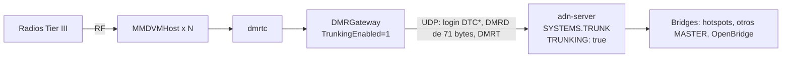

# Trunking DMR Tier III (dmrtc + DMRGateway)

Un **MASTER** con **`TRUNKING: true`** acepta **emplazamientos DMR Tier III**. Un emplazamiento es el controlador de trunking **dmrtc** (qradiolink) con **DMRGateway** configurado con **`TrunkingEnabled=1`**. Ambos hablan el **protocolo Homebrew DMR trunking v0.6** (DL5ABM / YO8RZZ). Brandmeister llama a este enlace «DMRTC link».

Un emplazamiento se conecta como un hotspot, pero con otros nombres de opcode. Después le dice al servidor tres cosas: qué talkgroups quiere, dónde están sus radios y sus datos cortos (SMS, estado). Además lleva **muchas llamadas a la vez** por un solo enlace.

Formato en el cable: [Protocolo Tier III](../protocols/tier3.md).

## Cómo encaja {#architecture}



| | Hotspot (HBP clásico) | Emplazamiento Tier III |
|---|---|---|
| Login | `RPTL` / `RPTK` / `RPTC` / `RPTO`, `RPTPING` | `DTCL` / `DTCK` / `DTCC` / `DTCO`, `DTCPING` |
| Tramas de voz | `DMRD`, 55 bytes | `DMRD`, 71 bytes (55 + un UUID de llamada de 16 bytes) |
| Talkgroups | OPTIONS, estáticos, TG activados por el usuario | **Suscripciones** DMRT, que duran hasta que el emplazamiento las retira |
| Llamadas a la vez | 2 (una por timeslot) | Muchas: sin contención de timeslot |
| Dónde está una radio (llamadas privadas) | Aprendido del tráfico (`SUB_MAP`) | **Registro** DMRT, y después el tráfico |
| Datos cortos | Tramas de datos DMR | Mensajes DMRT de UDT y de estado entre emplazamientos |

## Configuración del servidor {#server-configuration}

Añade un MASTER propio con su propio puerto UDP. El bloque comentado `TRUNK:` de `adn-server.example.yaml` sirve de plantilla:

```yaml
SYSTEMS:
  TRUNK:
    MODE: MASTER
    ENABLED: true
    TRUNKING: true
    REPEAT: true          # los emplazamientos de este sistema se oyen entre sí
    MAX_PEERS: 10         # número de emplazamientos
    IP: ""
    PORT: 62037           # el puerto al que se conecta DMRGateway
    PASSPHRASE: "cambiame"
    USE_ACL: true
    REG_ACL: DENY:1       # IDs de emplazamiento
    SUB_ACL: DENY:1       # IDs de radio (registros)
    TGID_TS1_ACL: PERMIT:ALL
    TGID_TS2_ACL: PERMIT:ALL
    SINGLE_MODE: false
```

- **La autenticación** funciona igual que con los hotspots. Primero se usa la contraseña propia del ID en `GLOBAL.USERS_PASS`; si no la hay, el `PASSPHRASE` del sistema. `REG_ACL`, `ALLOW_UNREG_ID` y `MAX_PEERS` se aplican a los IDs de emplazamiento.
- **El sistema es solo Tier III.** Un `RPTL` clásico (un hotspot, o un DMRGateway sin `TrunkingEnabled=1`) recibe `MSTNAK`. Deja los hotspots en otro MASTER o en el [proxy hotspot](hotspot-proxy.md).
- **`REPEAT`** (por defecto `true`): una llamada de un emplazamiento va a los demás emplazamientos de este sistema que la quieren. Con `false`, los emplazamientos de un mismo sistema no se oyen entre sí; sus llamadas siguen pasando por los bridges.

### Reglas que impone el validador {#validation}

Con `TRUNKING: true`, el servidor no arranca (y `--doctor` lo indica) si encuentra:

| Ajuste | Motivo |
|--------|--------|
| `MODE` distinto de `MASTER` | Los emplazamientos se conectan como hotspots. |
| El sistema es `PROXY.TARGET_SYSTEM` | El proxy integrado no transporta los login DTC* ni DMRT. Dale al MASTER de trunking su propio sistema y su propio `PORT`. |
| `PORT` ausente o que no es un entero > 0 | Los emplazamientos se conectan al puerto UDP del propio sistema. |
| `PORT` igual a `PROXY.LISTEN_PORT` o a `OBP_PROXY.LISTEN_PORT` | Los puertos chocarían (solo se comprueba en sistemas habilitados). |
| `GENERATOR` > 1 | Un solo puerto lleva todos los emplazamientos; usa `MAX_PEERS`. |
| `SINGLE_MODE: true` | Los talkgroups de un emplazamiento son sus suscripciones. |
| `TS1_STATIC` / `TS2_STATIC` no vacíos | Los emplazamientos se suscriben a sus propios talkgroups. |
| `DEFAULT_REFLECTOR` distinto de `0` | No se admite en un sistema de trunking. |

### ACL {#acls}

Cada ámbito (`GLOBAL` y luego el sistema) se aplica solo cuando su `USE_ACL` es `true`, igual que con la voz:

- **Registro** de una radio: se acepta si `SUB_ACL` permite el ID de la radio en todos los ámbitos activos.
- **Suscripción** a un talkgroup: se acepta si las listas de TS1 (`TGID_TS1_ACL`) o las de TS2 (`TGID_TS2_ACL`) lo permiten en todos los ámbitos activos. Un emplazamiento no tiene timeslots.
- **La voz** de un emplazamiento se comprueba con la lista del bit de slot que dmrtc pone en la trama. Mantén iguales `TGID_TS1_ACL` y `TGID_TS2_ACL` en un sistema de trunking, para que un talkgroup suscrito nunca se descarte en un slot.

### Recarga y reinicio {#reload}

- **`SIGHUP`** conserva los emplazamientos, sus suscripciones y sus registros. Tras la recarga, el servidor vuelve a aplicar los talkgroups suscritos (línea de log `Tier III subscriptions re-applied`). Hace lo mismo tras el reset de bridges del sistema.
- **Añadir o quitar `TRUNKING`** en un sistema existente (o cambiar su `MODE`) reinicia ese sistema. Sus peers se desconectan (los emplazamientos reciben `DTCCL`) y vuelven a conectarse.
- **Quitar el sistema** envía `DTCCL` a sus emplazamientos y libera sus talkgroups.
- **Un reinicio del proceso** empieza sin emplazamientos. DMRGateway vuelve a conectarse solo, y dmrtc envía de nuevo sus suscripciones. La ubicación de las radios vuelve cuando se registran de nuevo o transmiten.

## DMRGateway {#dmrgateway}

Usa **una instancia de DMRGateway solo para el enlace de trunking**. Con `TrunkingEnabled=1`, todas las redes de esa instancia se conectan con DTC*, y cada mensaje DMRT de dmrtc va a todas las redes habilitadas. Habilita en ella solo la red de ADN.

```ini
[General]
TrunkingEnabled=1
# Hacia dmrtc: sus «DMRGateway listen / send base ports» (44660 / 44670 por defecto,
# más el ID del gateway en la segunda instancia y siguientes)
RptAddress=127.0.0.1
RptPort=44660
LocalAddress=127.0.0.1
LocalPort=44670

[DMR Network 1]
Enabled=1
Name=ADN
Address=adn.example.org
# El PORT del sistema TRUNKING en adn-server.yaml
Port=62037
# El ID del emplazamiento: el ID de peer que ve el servidor (uno por emplazamiento)
Id=214901
# El PASSPHRASE del sistema, o la contraseña propia del ID del emplazamiento
Password=cambiame
PassAllPC=1
PassAllPC=2
PassAllTG=1
PassAllTG=2
Location=1
Debug=0
```

- `Port` es el **`PORT` del sistema de trunking**, no el puerto del proxy hotspot.
- `PassAllPC=1` y `PassAllPC=2` dejan pasar las llamadas privadas en los dos sentidos.
- `PassAllTG` pasa todos los talkgroups sin cambios. La guía de qradiolink usa en su lugar un prefijo de talkgroup de 7 cifras, por ejemplo `TGRewrite=2,1000001,1,1,999999` con prefijo `1000000` en dmrtc. Las dos formas funcionan: el servidor solo ve el talkgroup ya reescrito.

## dmrtc {#dmrtc}

En los ajustes de dmrtc:

- Tabla **Gateways**: exactamente **un** gateway con **Type `1`** (el gateway de trunking). Su ID es la instancia de DMRGateway anterior. **Talkgroup prefix** es `0` si no hay prefijo, o el prefijo que usan las reglas `TGRewrite`.
- **Use trunking protocol**: activado. Activa los mensajes DMRT y las suscripciones de talkgroups.
- **Send network registrations**: activado. Sin esto el servidor no sabe dónde está una radio hasta que transmite, así que las llamadas privadas y los SMS hacia ella fallan.
- **Subscribe static talkgroups**: activado. Los talkgroups de la página **Static talkgroups**, asignados al ID del gateway de trunking, se suscriben en cada login.

dmrtc también suscribe los talkgroups a los que sus radios se asocian por RF, y los retira cuando ninguna radio los necesita. Los talkgroups locales del emplazamiento nunca se suscriben.

## Qué funciona {#what-works}

- **Login y keepalive**: `DTCL` / `DTCK` / `DTCC` / `DTCO`, `DTCPING` / `DTCPONG`, `DTCCL` en los dos sentidos. El `DTCACK` final hace que DMRGateway avise a dmrtc con «MasterLogin», y dmrtc envía entonces sus suscripciones.
- **Suscripciones de talkgroups** por emplazamiento, confirmadas TG a TG. Una suscripción no tiene timeslot ni temporizador: dura hasta que el emplazamiento se da de baja o se va. Un talkgroup sin bridge todavía se crea como lo haría un talkgroup activado por el usuario.
- **Llamadas de grupo hacia un emplazamiento**: todas las llamadas de un talkgroup suscrito, **a la vez** que las demás, sin contención de dos slots. Cada trama mide 71 bytes y lleva el UUID de la llamada: el del emplazamiento de origen si vino de un emplazamiento; si no, un UUID estable generado a partir del stream.
- **Llamadas de grupo desde un emplazamiento**: muchas a la vez. Cada llamada es su propio stream para el control de duplicados y pérdidas, el control de bucle, el loop guard y la regla de una conversación por talkgroup. Las llamadas pasan por los bridges hacia hotspots, otros MASTER y OpenBridge como las de un hotspot.
- **De emplazamiento a emplazamiento**: en el mismo sistema mediante `REPEAT`; entre sistemas de trunking mediante los bridges. Un emplazamiento nunca recibe de vuelta su propia llamada.
- **Registro y roaming de radios**: una radio está en un solo emplazamiento a la vez. Cuando se registra en uno nuevo, el emplazamiento anterior recibe una baja (de-registration) para ella. El registro se mantiene aunque el emplazamiento vuelva a conectarse (dmrtc no registra sus radios por segunda vez). Si la radio se oye en otro sitio después de registrarse (salió del repetidor sin darse de baja), manda la ubicación más reciente.
- **Voz privada y datos unitarios** hacia una radio registrada van solo a su emplazamiento, nunca en difusión. Las llamadas privadas y los datos que salen de un emplazamiento llegan a los usuarios de hotspots y a OpenBridge como siempre.
- **UDT (SMS) y estado** entre emplazamientos: un mensaje de grupo va a todos los demás emplazamientos suscritos al talkgroup, en cualquier sistema de trunking; uno privado va al emplazamiento de la radio destino. La aceptación del UDT vuelve al remitente.
- **Establecimiento de llamada privada** (DMRT `0x07`): se encamina al emplazamiento de la radio llamada, o se rechaza (`0x49`) si no está registrada en otro emplazamiento. La aceptación y el rechazo vuelven a quien llama.
- **Eco (TG 9990)**: la reproducción va solo al emplazamiento que lo activó, mientras dure.
- El talker alias dentro de las tramas de voz, la grabación, los plugins y los eventos de informe funcionan como con los hotspots.

## Limitaciones {#limitations}

- **Los SMS entre emplazamientos no llegan a RF con el dmrtc actual.** dmrtc ignora los mensajes UDT (`0x45`) y de aceptación de UDT (`0x46`) que recibe de la red. Compara el opcode sin el bit de «desde la red». El servidor sigue el protocolo; los registros y las suscripciones (`0x41`–`0x44`) funcionan.
- **Los mensajes UDT y de estado solo viajan entre emplazamientos Tier III.** No hay conversión entre el UDT de DMRT y las tramas de datos DMR (SMS) que envían los hotspots. Las tramas de datos DMR hacia una radio registrada se envían a su emplazamiento sin cambios.
- **El establecimiento de llamada privada** (`0x07`–`0x09`) se encamina, pero el dmrtc actual no lo envía. La voz privada usa las tramas de voz.
- **Las llamadas privadas y los SMS necesitan saber dónde está la radio**: un registro (Send network registrations) o tráfico oído de la radio. Si un emplazamiento vuelve a conectarse, sus radios siguen registradas; tras un reinicio del servidor se pierden hasta que las radios se registran de nuevo o transmiten. Las llamadas privadas desde un emplazamiento a IDs que no tienen 7 cifras solo llegan a emplazamientos del mismo sistema (la regla general de las llamadas privadas).
- **Talkgroups a los que un emplazamiento no puede suscribirse** (se rechazan con `0` en la confirmación): 0–9, 4000, 5000, 9990–9999 y cualquiera por encima de 16777215. El TG 9 está incluido, así que usa los talkgroups locales de dmrtc para el tráfico local del emplazamiento. Un emplazamiento puede tener como mucho 512 talkgroups.
- **El TG / ID 4000 no hace nada desde un emplazamiento.** Sus talkgroups son sus suscripciones. Los mensajes de voz del servidor no se envían a los emplazamientos: ni la respuesta de voz del TG 4000 ni el audio informativo de 9991–9999, que sale por el TG 9.
- **Sin funciones de hotspot**: OPTIONS (`DTCO` se guarda como referencia pero nunca se aplica), `TS1_STATIC` / `TS2_STATIC`, `SINGLE_MODE`, `DEFAULT_REFLECTOR`, `GENERATOR`, el proxy integrado y el paquete suelto de talker alias (`DMRA`).
- **Eco**: hay un solo origen de eco por sistema y talkgroup. Si dos emplazamientos de un mismo sistema activan el 9990 dentro del retardo de reproducción, una reproducción puede ir al otro emplazamiento.
- **Monitor**: los emplazamientos aparecen como peers del sistema, y los talkgroups suscritos aparecen como piernas estáticas del sistema en TS1 y TS2. El monitor no muestra las suscripciones de cada emplazamiento. Las llamadas entre emplazamientos de un mismo sistema solo aparecen como eventos RX.
- **Las sondas de estado del servidor** (`RPTL` con ID 4294967295) se rechazan en un sistema de trunking. Apúntalas a otro MASTER.
- El registro vive en memoria: `SIGHUP` lo conserva, un reinicio no.

## Logs que verás {#logs}

Con el sistema llamado `TRUNK`, el emplazamiento 214901 y la radio 2141234:

```text
(TRUNK) Repeater Logging in with Radio ID: 214901, 203.0.113.10:62031
(TRUNK) Peer 214901 has completed the login exchange successfully (global passphrase)
(TRUNK) Tier III site 214901 has sent options ... (not applied)
(TRUNK) Tier III site 214901 subscribed TGs [214, 2141, 91]
(TRUNK) Tier III site 214901: subscription REFUSED for TGs [9]
(TRUNK) Tier III site 214901: MS 2141234 registered
(TRUNK) Tier III site 214902: MS 2141234 registered (roamed from TRUNK site 214901)
(TRUNK) Tier III site 214902: private UDT from 2141234 to 2145678 -> TRUNK/214901
(TRUNK) Tier III site 214901 gone: released TGs [2141]
(TRUNK) Tier III subscriptions re-applied: TGs [214, 91]
(CONFIG-RELOAD) TRUNK changed from MASTER to MASTER (TRUNKING): peers dropped, protocol restarted
```

Otras líneas útiles:

- `Tier III site N: registration of MS M DENIED`: `SUB_ACL` rechazó la radio.
- `... UDT from A to B has no destination site`: ningún otro emplazamiento tiene el talkgroup, o la radio no está registrada.
- `private call setup A -> B rejected (MS not registered at another site)`.
- `UNIT Data Bridged to Tier III site N on TRUNK DST_ID: M`: datos unitarios de otro sistema entregados al emplazamiento de la radio.

En `DEBUG` hay líneas para los mensajes DMRT descartados, el encaminamiento de estados y el retorno de aceptaciones y rechazos.

## Resolución de problemas {#troubleshooting}

| Síntoma | Causa y solución |
|---------|------------------|
| Log del servidor: `Unrecognized command. Raw HBP PDU: b'DTCL...'` | El emplazamiento llegó a un sistema sin `TRUNKING: true`: un `Port` equivocado en DMRGateway, o falta la clave. |
| Log del servidor: `Classic HBP RPTL from ... refused: Tier III trunking system (DMRGateway TrunkingEnabled=1 only)` | Un hotspot, o un DMRGateway sin `TrunkingEnabled=1`, apunta al puerto de trunking. |
| DMRGateway reintenta el login sin parar | `Password` o `Id` incorrectos, `REG_ACL`, un ID no registrado con `ALLOW_UNREG_ID: false`, o `MAX_PEERS` alcanzado. El servidor registra `FAILED the login exchange`, `Invalid Login` o `Maximum number of peers exceeded`. |
| DMRGateway registra `Logged into the master via DTC protocol successfully`, pero el servidor nunca registra `subscribed TGs` | En dmrtc: Use trunking protocol desactivado; Subscribe static talkgroups desactivado o la página Static talkgroups vacía; ningún gateway tiene Type 1, o más de uno lo tiene; los talkgroups estáticos están asignados a otro ID de gateway. |
| `subscription REFUSED for TGs [...]` | Un talkgroup reservado (ver [Limitaciones](#limitations)), un talkgroup que deniegan tanto las ACL de TS1 como las de TS2, o el límite de 512 talkgroups. |
| Un talkgroup suscrito solo se oye en algunas llamadas | `TGID_TS1_ACL` y `TGID_TS2_ACL` distintas: iguálalas ([ACL](#acls)). |
| Las llamadas privadas a una radio de un emplazamiento no llegan | Send network registrations está desactivado y la radio no ha transmitido desde que su emplazamiento se conectó, o el servidor se ha reiniciado desde que la radio se registró. Busca `MS ... registered`. |
| Los emplazamientos de un mismo sistema no se oyen | `REPEAT: false` en el sistema de trunking. |
| Los SMS entre emplazamientos nunca aparecen en las radios | El problema de dmrtc descrito en [Limitaciones](#limitations). El log del servidor muestra el UDT encaminado (`UDT from ... -> ...`). |

## Ver también

- [Protocolo Tier III](../protocols/tier3.md): opcodes de login, el DMRD de 71 bytes, los mensajes DMRT.
- [Configuración](configuration.md#systems-master): claves de MASTER.
- [Llamadas privadas](private-calls.md): `SUB_MAP` y datos unitarios.
- [Números especiales](special-numbers.md): TG 4000, 9990–9999.
- [Guía de trunking de dmrtc y MMDVM](https://qradiolink.org/docs/MMDVM/dmr-trunking.html) (qradiolink, en inglés).
